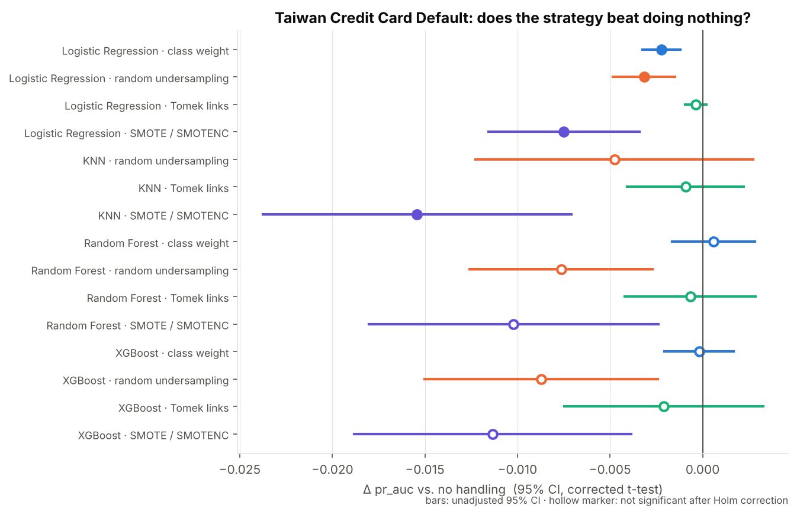
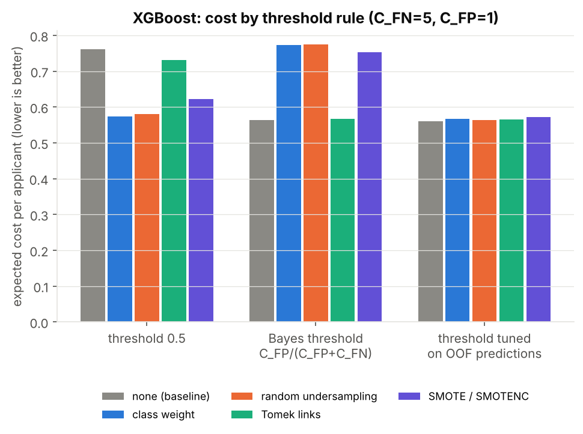
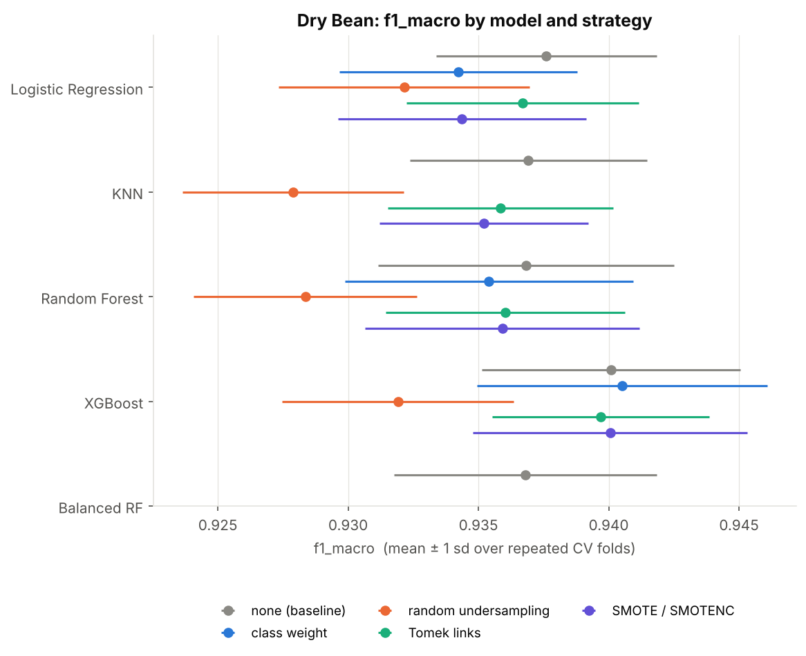

# Imbalanced Classification: What Actually Helps?

**A leakage-free benchmark of class-imbalance strategies, with cost-based decisions for credit-default screening.**

> 繁體中文程式碼導讀：[docs/CODE_GUIDE.zh-TW.md](docs/CODE_GUIDE.zh-TW.md)（程式內註解也是中文）


## TL;DR

On two real datasets and in a controlled experiment where imbalance runs from 3.5:1 to 100:1:

1. **Resampling doesn't make models better at ranking risk.** Across 5 models, random undersampling, Tomek links, SMOTE/SMOTENC and class weighting fail to improve over doing nothing. Across 60 threshold-free comparisons (PR-AUC, best-threshold F1, macro-F1, worst-class recall), each run as a corrected significance test, **none** is significantly better and **11** are significantly *worse*, mostly SMOTE and random undersampling.
2. **What resampling actually does is move the decision threshold.** At the default 0.5 threshold every strategy raises F1 a lot (XGBoost: 0.464 → 0.542). But the best F1 a model can reach at *any* threshold doesn't move at all (0.550 vs 0.550).
3. **So set the threshold explicitly, from the business cost.** For credit screening, an untouched XGBoost with a cost-tuned threshold gave the lowest cost on the held-out test set: **0.561 cost units per applicant, a 49% saving vs. approving everyone**. Its probabilities also stay calibrated (Brier 0.136, vs. 0.182–0.184 after class weighting or undersampling).
4. **The cost-optimal threshold rule depends on calibration.** The textbook rule *t\* = C_FP / (C_FP + C_FN)* works on calibrated probabilities. It misfires badly on resampled models: with class weighting or undersampling it rejected over 99% of applicants. The prior-correction formula of Dal Pozzolo et al. (2015) restores the undersampled model's calibration (Brier 0.184 → 0.136).

The practical recommendation: **keep all the data, train on the real class distribution, and turn costs into a threshold.** Reach for class weights only when the model can't take an external threshold.

---

## Why this project exists (v1 → v2)

Version 1 of this repo compared undersampling methods on a single train/test split. Its README claimed that undersampling suits "severely imbalanced multiclass" problems like Dry Bean. **Its own result tables said otherwise**: on Dry Bean, all four classifiers scored *lower* with undersampling than without. The rewrite fixes the method, not just the code:

| v1 problem | v2 fix |
|---|---|
| One train/test split. Differences of 0.002–0.01 F1 were reported as findings, though identical training data in a different row order already moved F1 by 0.004 | 5×3 repeated stratified CV (15 paired scores per configuration), Nadeau–Bengio corrected t-test, Holm correction |
| "Optimized" hyperparameters hard-coded, with no tuning code; the same values reused on both datasets | Randomized search per dataset × model, on the training split only |
| Plain SMOTE on nominal features (SEX, EDUCATION, MARRIAGE) creates impossible values like `SEX = 1.37` | SMOTENC for nominal columns; a test asserts that synthetic rows keep valid category codes |
| Undocumented codes (`EDUCATION ∈ {0,5,6}`, `MARRIAGE = 0`) left in; categorical codes z-scored | Cleaned and documented in `data.py`; categoricals are one-hot encoded after resampling |
| Macro-F1 at threshold 0.5 used for a default-detection problem | Positive-class PR-AUC, recall, precision, F1, MCC, Brier, threshold-free `f1_best`, plus an explicit cost model |
| No class-weighting or threshold-moving baseline | Both included. They turn out to be the most important comparisons |
| "Imbalance severity decides the technique", concluded from two unrelated datasets (dataset, class count and imbalance all differ at once) | Controlled experiment: one dataset, minority class subsampled to IR = 3.5, 10, 25, 50, 100 |
| A single 666-line script, no tests | Package with config, CLI, 41 tests (including a leakage "spy" test) and GitHub Actions CI |

## Datasets

| Dataset | Task | Rows | Features | Imbalance | Primary metric |
|---|---|---|---|---|---|
| [Taiwan Credit Card Default](https://archive.ics.uci.edu/dataset/350/default+of+credit+card+clients) (Yeh & Lien, 2009) | binary (default next month) | 30,000 | 23 (3 nominal) | 3.5 : 1 | PR-AUC of the default class |
| [Dry Bean](https://archive.ics.uci.edu/dataset/602/dry+bean+dataset) (Koklu & Ozkan, 2020) | 7-class | 13,611 | 16 numeric | 6.8 : 1 | macro-F1 |

File integrity is checked against SHA-256 hashes in `data.py`.

## Method

```
all data ──► 80 % train ──► (1) tune each model: RandomizedSearchCV, 3-fold, train only
         │                ├► (2) compare strategies: 5×3 repeated stratified CV, paired folds
         │                │      └► out-of-fold probabilities → choose decision thresholds
         │                └► (3) refit every configuration on all of train
         └► 20 % test ───────► final metrics, costs and calibration (touched exactly once)
```

Every configuration is one `imblearn.Pipeline`: **scale numerics → resample → one-hot categoricals → model**. The sampler runs only inside `fit`, so validation and test folds always keep the real class distribution. `tests/test_pipeline.py` checks this directly: a spy sampler records how many rows it receives.

- **Strategies:** none · class weight (XGBoost via balanced sample weights) · random undersampling · Tomek links · SMOTE / SMOTENC · plus Balanced Random Forest (undersampling inside each tree's bootstrap).
- **Models:** logistic regression, KNN, random forest, XGBoost, balanced RF. RBF-SVM from v1 was dropped: its training cost grows roughly with *n²*, and logistic regression already covers the linear-model role. KNN has no loss to weight, and balanced RF already resamples, so those combinations are skipped.
- **Statistics:** each strategy vs. *none*, per model, using the [Nadeau & Bengio (2003)](https://link.springer.com/article/10.1023/A:1024068626366) corrected resampled t-test. Overlapping CV training sets make a plain paired t-test overconfident. p-values are Holm-adjusted.

## Results

### 1. Credit card: no strategy ranks defaulters better than doing nothing



PR-AUC, mean ± sd over 15 CV folds (full table: [`results/credit_card/cv_summary.csv`](results/credit_card/cv_summary.csv)):

| Model | none | class weight | random under | Tomek | SMOTENC |
|---|---|---|---|---|---|
| Logistic regression | **0.507** ± .015 | 0.504 ▼ | 0.504 ▼ | 0.506 | 0.499 ▼ |
| KNN | **0.516** ± .014 | n/a | 0.511 | 0.515 | 0.501 ▼ |
| Random forest | 0.561 ± .011 | **0.562** | 0.553 | 0.560 | 0.551 |
| XGBoost | **0.561** ± .010 | 0.561 | 0.552 | 0.559 | 0.550 |
| Balanced RF | 0.559 ± .011 | | | | |

▼ = significantly worse than *none* (Holm-adjusted p < 0.05). Nothing was significantly better. Average rank across logistic regression, RF and XGBoost (1 = best): none 1.77 · Tomek 2.12 · class weight 2.43 · random under 4.13 · SMOTENC 4.54.

### 2. The "improvement" is a threshold effect

| XGBoost, CV mean | none | class weight | random under | SMOTENC |
|---|---|---|---|---|
| F1 at threshold 0.5 | 0.464 | 0.542 ▲ | 0.539 ▲ | 0.536 ▲ |
| Recall at threshold 0.5 | 0.349 | 0.617 | 0.626 | 0.550 |
| **Best F1 over all thresholds** | **0.550** | 0.550 | 0.548 | 0.542 ▼ |

At 0.5, every strategy beats *none* by a wide, highly significant margin. That is exactly how v1-style results look convincing. Once the threshold is free, the advantage disappears, and SMOTENC is significantly worse. The same pattern holds for all four models ([`cv_vs_baseline.csv`](results/credit_card/cv_vs_baseline.csv)).

### 3. Cost-based decisions (held-out test set)

Assumed costs: approving a defaulter costs **C_FN = 5** and rejecting a good payer costs **C_FP = 1** (relative units, set in `configs/default.yaml`). Three threshold rules are compared: plain 0.5; the Bayes rule *t\* = C_FP/(C_FP+C_FN) = 0.167*; and a threshold tuned to minimize cost on **out-of-fold training predictions**, which never touches the test set.



| XGBoost, test set | threshold 0.5 | Bayes threshold | tuned threshold |
|---|---|---|---|
| none | 0.762 | 0.563 | **0.561** (−49.3 % vs. approve-all) |
| class weight | 0.573 | 0.773 (rejects 99 %) | 0.567 |
| random undersampling | 0.581 | 0.774 (rejects 99 %) | 0.563 |
| SMOTENC | 0.622 | 0.753 | 0.572 |

*Expected cost per applicant; lower is better.* Once each strategy uses its own tuned threshold, the strategies end up within about 0.01 of each other. The baseline is cheapest. The closed-form Bayes rule works only for the configurations whose probabilities stay calibrated (*none*, and *Tomek*, which removes just 7.5 % of the majority class).

**Is this conclusion fragile to the cost assumption?** No. Sweeping C_FN/C_FP from 1 to 20, the tuned-threshold savings of all five strategies stay within 1 percentage point of each other for cost ratios ≥ 5. Below that, SMOTENC trails by up to 3.6 pp, and no strategy overtakes the baseline by a meaningful margin ([`cost_sensitivity.csv`](results/credit_card/cost_sensitivity.csv)):


### 4. Calibration: resampling distorts probabilities, and it can be undone


Class weighting, undersampling and SMOTENC all overestimate default risk. Test Brier scores: none 0.136 · class weight 0.182 · random under 0.184 · SMOTENC 0.173. Applying the prior correction *p = βp_s / (βp_s − p_s + 1)* ([Dal Pozzolo et al., 2015](https://doi.org/10.1109/SSCI.2015.33)) to the undersampled model brings its Brier score back to **0.136**. This matters whenever probabilities feed a downstream decision such as pricing, credit limits or expected-loss provisioning.

### 5. Dry Bean (7 classes): the same story, and the "rare" class isn't the hard one



- Random undersampling is **significantly worse for all four models** it applies to (macro-F1 −0.006 to −0.009). It cuts the training set from 10,888 to 2,926 rows. No strategy is significantly better than *none*, on macro-F1 or on worst-class recall.
- The minority class BOMBAY (3.8 %) reaches **≥ 99 % test recall in all 20 configurations**, because it is trivially separable. The hardest class is SIRA, the *second-largest* class (recall 0.81–0.90; the worst class in 15 of 20 configurations). Rebalancing class counts cannot fix class *overlap*.

### 6. Controlled imbalance: does severity change the answer?

The credit-card data is resampled down to IR = 3.5, 10, 25, 50 and 100 (only defaulters are removed), and evaluated with 5×2 repeated CV.


- **Ranking quality** (PR-AUC divided by prevalence, top row; best-threshold F1, bottom row): no strategy is consistently better than *none* at any IR. The few points where one edges ahead are well inside the fold-to-fold spread. SMOTENC falls further behind as imbalance grows (XGBoost lift at IR 100: 3.6 vs. 5.6 for *none*).
- **At threshold 0.5** (middle row): *none* collapses. Recall is effectively 0 from IR 25 upward, because the model almost never predicts above 0.5.
- **So severity doesn't make resampling more useful. It makes ignoring the threshold more costly.** At IR ≥ 50 there are only 234–467 positives, so the bands are wide. Treat those points as indicative.

## Limitations

- Hyperparameters were tuned once per model under *none* and shared across strategies. That is fair across strategies, but it may slightly under-serve the resampled variants.
- Costs are relative and assumed. The sensitivity sweep shows the ranking of strategies is stable, but absolute savings depend on real loss-given-default and margin figures.
- Two datasets plus one controlled family is evidence, not a universal law. Extreme imbalance (fraud-style, >500:1) and very small datasets may behave differently.
- The Friedman test reported in `friedman.json` treats CV folds as independent, so its p-value is optimistic. The per-strategy conclusions rest on the corrected t-tests.

**Next steps:** SHAP explanations and group-fairness checks (error rates by SEX / AGE) for the credit model; probability calibration (isotonic / Platt) as an extra strategy; a small Streamlit demo for interactive threshold and cost exploration.

## Run it

```bash
cd imbalance-benchmark
pip install -e ".[dev]"
pytest -q                                      # 41 tests, synthetic data, ~10 s
imbalance-lab run --config configs/quick.yaml  # smoke run, ~2 min
imbalance-lab run                              # full benchmark, ~28 min on 2 CPU cores
imbalance-lab run --stages cost                # re-run only the cost analysis after editing costs
```

The data is downloaded from UCI on first run. Alternatively, put `default of credit card clients.xls` and `Dry_Bean_Dataset.xlsx` into `data/`. Stages: `tune → cv → stats → test → cost → ir`. Each stage writes its outputs to `results/` and `figures/`, and later stages read them back. The `.npz` prediction caches are git-ignored; re-create them with the `cv` and `test` stages.

## Structure

```
imbalance-benchmark/
├── configs/            default.yaml (full run), quick.yaml (smoke test)
├── src/imbalance_lab/
│   ├── data.py         loading, cleaning, SHA-256 check, controlled-IR subsampling
│   ├── strategies.py   samplers (random under, Tomek, SMOTE/SMOTENC)
│   ├── models.py       models, class-weighted XGBoost, compatibility rules, search spaces
│   ├── pipeline.py     scale → resample → encode → model
│   ├── metrics.py      PR-AUC, MCC, Brier, f1_best, worst-class recall …
│   ├── experiments.py  tuning, repeated CV with OOF predictions, test evaluation, IR study
│   ├── stats.py        corrected resampled t-test, Holm, average ranks
│   ├── cost.py         expected cost, Bayes/tuned thresholds, prior correction, sensitivity
│   ├── plots.py        figures
│   └── cli.py          `imbalance-lab run`
├── tests/              leakage spy, SMOTENC validity, cost/stats math, end-to-end CV
├── results/            CSV / JSON outputs
├── figures/            PNG figures
└── docs/CODE_GUIDE.zh-TW.md
```

## References

- Nadeau, C., & Bengio, Y. (2003). Inference for the generalization error. *Machine Learning*, 52, 239–281.
- Dal Pozzolo, A., Caelen, O., Johnson, R. A., & Bontempi, G. (2015). Calibrating probability with undersampling for unbalanced classification. *IEEE SSCI*.
- Elkan, C. (2001). The foundations of cost-sensitive learning. *IJCAI*.
- Chawla, N. V., et al. (2002). SMOTE: Synthetic minority over-sampling technique. *JAIR*, 16, 321–357.
- Yeh, I. C., & Lien, C. H. (2009). The comparisons of data mining techniques for the predictive accuracy of probability of default of credit card clients. *Expert Systems with Applications*, 36(2), 2473–2480.
- Koklu, M., & Ozkan, I. A. (2020). Multiclass classification of dry beans using computer vision and machine learning techniques. *Computers and Electronics in Agriculture*, 174, 105507.
