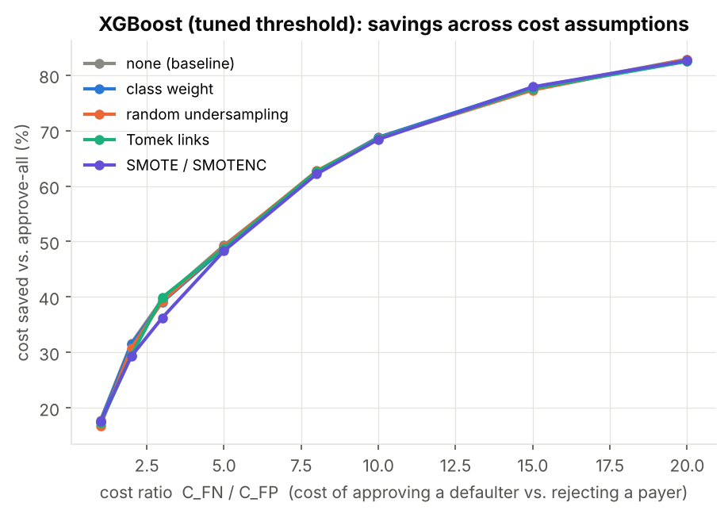
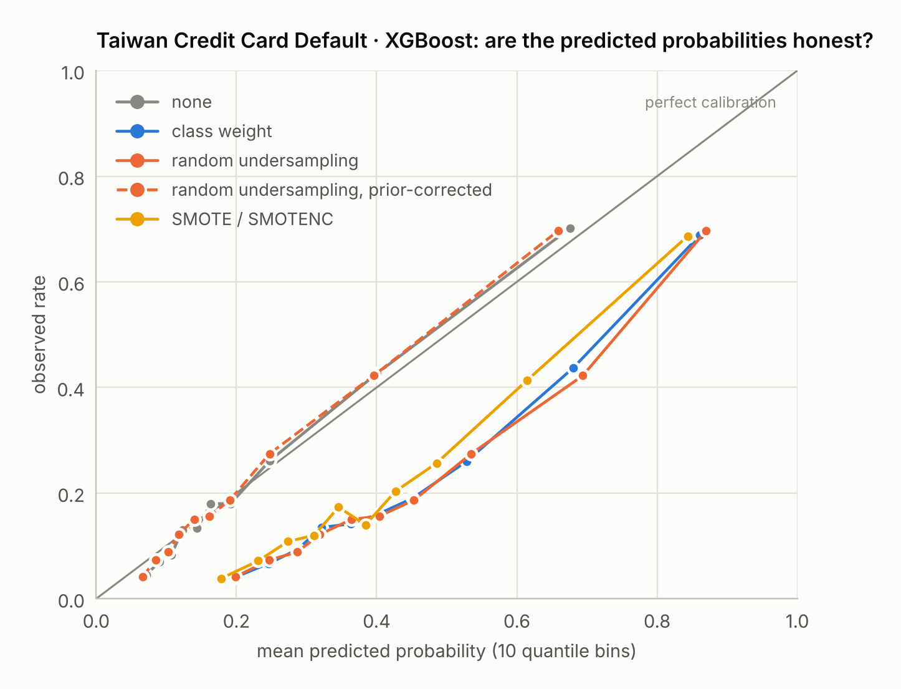
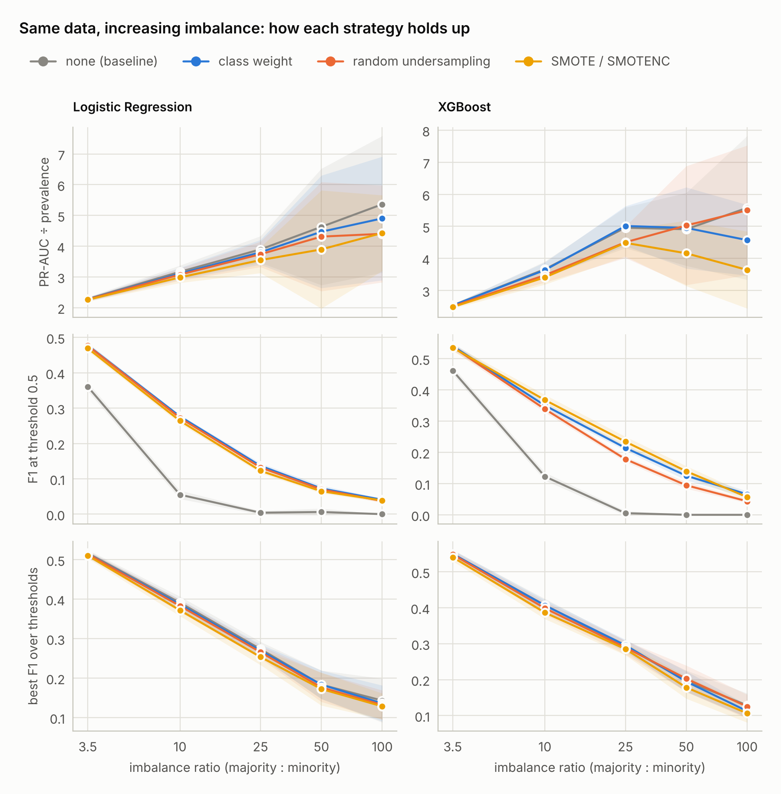
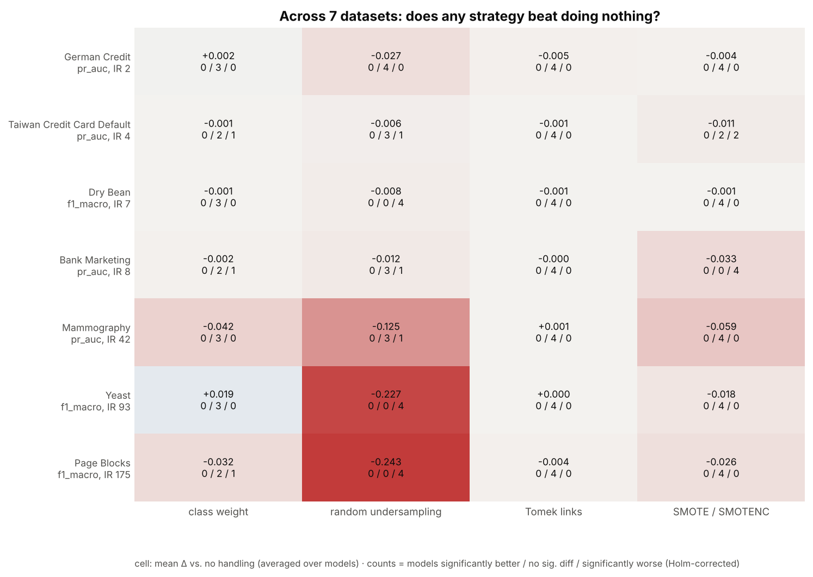

# Imbalanced Classification: What Actually Helps?

**A leakage-free benchmark of class-imbalance strategies on 7 datasets, with cost-based decisions for credit-default screening.**

> 繁體中文程式碼導讀：[docs/CODE_GUIDE.zh-TW.md](docs/CODE_GUIDE.zh-TW.md)（程式內註解也是中文）


## TL;DR

The study covers two primary datasets (credit-card default, Dry Bean), **five validation datasets** from other domains (imbalance ratios from 2.3:1 to 175:1), and a controlled experiment that pushes imbalance from 3.5:1 to 100:1.

1. **Resampling doesn't make models better at ranking.** Each strategy was compared with doing nothing on 105 dataset × model pairs, scored on each dataset's primary metric without a decision threshold (PR-AUC or macro-F1), using a corrected significance test. **0 were significantly better and 24 were significantly worse.** Most of the losses are random undersampling (15) and SMOTE (6).
2. **What resampling actually does is move the decision threshold.** At the default 0.5 threshold, strategies raise F1 in 31 of 60 binary comparisons. Credit-card XGBoost goes from 0.464 to 0.542. But the best F1 a model can reach at *any* threshold never improves: 0 of 60 comparisons were better, 5 were worse.
3. **So set the threshold explicitly, from the business cost.** On the held-out test sets of all four binary datasets, an untouched model with a cost-tuned threshold was never beaten. Across 60 bootstrap comparisons, no strategy was ever significantly cheaper. The same untouched model with the default 0.5 threshold was significantly more expensive in 19 of 20 cases. On credit screening this gives **0.561 cost units per applicant, a 49 % saving vs. approving everyone**.
4. **Resampling distorts probabilities.** The untouched XGBoost had the best Brier score on all 4 binary datasets. On three of them, applying the textbook cost threshold *t\* = C_FP / (C_FP + C_FN)* to a class-weighted or undersampled model rejected 72–99 % of applicants, against 15–58 % for the untouched model. The prior correction of Dal Pozzolo et al. (2015) undoes most of the distortion.
5. **The exception: classes with only a handful of examples.** On Yeast (rarest class: 5 rows), worst-class recall without any handling is 0 for every model. On Page Blocks (28 rows) it is 0.45–0.63. Class weighting and SMOTE raised worst-class recall in all 14 model comparisons on these two datasets, though only 2 are individually significant with so few rare examples per fold. For tree models they change what is learned, which no post-hoc decision rule can recover. Random undersampling remains harmful there too: it cut Yeast training data to 40 rows.

**Recommendation:** keep all the data, train on the real class distribution, and turn costs into a threshold. Use class weights when a class has only tens of examples or when the model can't take an external threshold. Avoid random undersampling and SMOTE as defaults.

---

## Why this project exists (v1 → v2)

Version 1 of this repo compared undersampling methods on a single train/test split. Its README claimed that undersampling suits "severely imbalanced multiclass" problems like Dry Bean. **Its own result tables said otherwise**: on Dry Bean, all four classifiers scored *lower* with undersampling than without. The rewrite fixes the method, not just the code:

| v1 problem | v2 fix |
|---|---|
| One train/test split. Differences of 0.002–0.01 F1 were reported as findings, though identical training data in a different row order already moved F1 by 0.004 | 5×3 repeated stratified CV (15 paired scores per configuration), Nadeau–Bengio corrected t-test, Holm correction |
| "Optimized" hyperparameters hard-coded, with no tuning code; the same values reused on both datasets | Randomized search per dataset × model, on the training split only |
| Plain SMOTE on nominal features (SEX, EDUCATION, MARRIAGE) creates impossible values like `SEX = 1.37` | SMOTENC for nominal columns; a test asserts that synthetic rows keep valid category codes |
| Undocumented codes (`EDUCATION ∈ {0,5,6}`, `MARRIAGE = 0`) left in; categorical codes z-scored | Cleaned and documented in `data.py`; categoricals one-hot encoded (before distance-based samplers, after SMOTENC) |
| Macro-F1 at threshold 0.5 used for a default-detection problem | Positive-class PR-AUC, recall, precision, F1, MCC, Brier, threshold-free `f1_best`, plus an explicit cost model |
| No class-weighting or threshold-moving baseline | Both included. They turn out to be the most important comparisons |
| "Imbalance severity decides the technique", concluded from two unrelated datasets (dataset, class count and imbalance all differ at once) | Controlled experiment: one dataset, minority class subsampled to IR = 3.5, 10, 25, 50, 100 |
| Conclusions drawn from 2 datasets | 5 further validation datasets (banking, credit with an official cost matrix, medical imaging, biology, document layout) re-run through the identical pipeline |
| A single 666-line script, no tests | Package with config, CLI, 49 tests (including a leakage "spy" test) and GitHub Actions CI |

## Datasets

| Role | Dataset | Domain | Task | Rows | Features | Imbalance (max : min) | Primary metric |
|---|---|---|---|---|---|---|---|
| primary | [Taiwan Credit Card Default](https://archive.ics.uci.edu/dataset/350/default+of+credit+card+clients) | consumer credit | binary | 30,000 | 23 (3 nominal) | 3.5 : 1 | PR-AUC |
| primary | [Dry Bean](https://archive.ics.uci.edu/dataset/602/dry+bean+dataset) | agriculture / vision | 7-class | 13,611 | 16 | 6.8 : 1 | macro-F1 |
| validation | [Bank Marketing](https://archive.ics.uci.edu/dataset/222/bank+marketing) | banking / marketing | binary | 41,188 | 20 (10 nominal) | 7.9 : 1 | PR-AUC |
| validation | [German Credit](https://archive.ics.uci.edu/dataset/144/statlog+german+credit+data) | credit, **official 5 : 1 cost matrix** | binary | 1,000 | 20 (13 nominal) | 2.3 : 1 | PR-AUC |
| validation | Mammography (Woods et al., 1993; OpenML 310) | medical imaging | binary | 11,183 | 6 | 42 : 1 | PR-AUC |
| validation | [Yeast](https://archive.ics.uci.edu/dataset/110/yeast) | biology | 10-class | 1,484 | 8 | 93 : 1 (rarest class: 5 rows) | macro-F1 |
| validation | [Page Blocks](https://archive.ics.uci.edu/dataset/78/page+blocks+classification) | document analysis | 5-class | 5,473 | 10 | 175 : 1 (rarest class: 28 rows) | macro-F1 |

Each file is checked against a SHA-256 hash in `data.py`. If a file is missing, the loader tries UCI first and then a GitHub mirror, and accepts a mirror only if its hash matches. Every file used here was confirmed byte-identical across at least two independent mirrors, with row and class counts matching the official documentation. Dataset-specific cleaning, documented in `data.py`:

- **Bank Marketing:** drops `duration`. Call length is only known after the call, and UCI flags it as a target leak.
- **Bank Marketing:** recodes `pdays = 999` ("never contacted") into a flag.
- **Yeast:** drops the sequence-name ID column.

## Method

```
all data ──► 80 % train ──► (1) tune each model: RandomizedSearchCV, 3-fold, train only
         │                ├► (2) compare strategies: 5×3 repeated stratified CV, paired folds
         │                │      └► out-of-fold probabilities → choose decision thresholds
         │                └► (3) refit every configuration on all of train
         └► 20 % test ───────► final metrics, costs and calibration (touched exactly once)
```

Every configuration is one `imblearn.Pipeline`: **scale numerics → one-hot categoricals → resample → model**. SMOTENC is the one exception: it resamples *before* one-hot encoding, because it needs the raw category codes. The sampler runs only inside `fit`, so validation and test folds always keep the real class distribution. `tests/test_pipeline.py` checks this directly: a spy sampler records how many rows it receives.

- **Strategies:** none · class weight (XGBoost via balanced sample weights) · random undersampling · Tomek links · SMOTE / SMOTENC · plus Balanced Random Forest (undersampling inside each tree's bootstrap).
- **Models:** logistic regression, KNN, random forest, XGBoost, balanced RF. RBF-SVM from v1 was dropped: its training cost grows roughly with *n²*, and logistic regression already covers the linear-model role. KNN has no loss to weight, and balanced RF already resamples, so those combinations are skipped.
- **Statistics:** each strategy vs. *none*, per model, using the [Nadeau & Bengio (2003)](https://link.springer.com/article/10.1023/A:1024068626366) corrected resampled t-test. Overlapping CV training sets make a plain paired t-test overconfident. p-values are Holm-adjusted. Test-set cost differences get a paired bootstrap 95 % CI (2,000 resamples).
- **Validation datasets** use the same models, strategies and code, with 5×2 instead of 5×3 CV and 10 instead of 12 tuning draws (`configs/validation.yaml`).
- **Edge cases surfaced by validation, and handled:**
  - SMOTE's neighbour count shrinks automatically when a class has fewer than 6 training rows.
  - KNN caps *k* at the training-set size, since undersampling Yeast leaves 30 rows.
  - Metrics are computed over the classes actually present in each fold.

## Results

### 1. Credit card: no strategy ranks defaulters better than doing nothing


PR-AUC, mean ± sd over 15 CV folds (full table: [`results/credit_card/cv_summary.csv`](results/credit_card/cv_summary.csv)):

| Model | none | class weight | random under | Tomek | SMOTENC |
|---|---|---|---|---|---|
| Logistic regression | **0.507** ± .015 | 0.504 ▼ | 0.504 ▼ | 0.506 | 0.499 ▼ |
| KNN | **0.516** ± .014 | n/a | 0.511 | 0.515 | 0.501 ▼ |
| Random forest | 0.561 ± .011 | **0.562** | 0.553 | 0.560 | 0.551 |
| XGBoost | **0.561** ± .010 | 0.561 | 0.552 | 0.559 | 0.550 |
| Balanced RF | 0.559 ± .011 | | | | |

▼ = significantly worse than *none* (Holm-adjusted p < 0.05). Nothing was significantly better. Average rank across logistic regression, RF and XGBoost (1 = best): none 1.76 · Tomek 2.19 · class weight 2.37 · random under 4.11 · SMOTENC 4.58.

### 2. The "improvement" is a threshold effect

| XGBoost, CV mean | none | class weight | random under | SMOTENC |
|---|---|---|---|---|
| F1 at threshold 0.5 | 0.464 | 0.542 ▲ | 0.539 ▲ | 0.536 ▲ |
| Recall at threshold 0.5 | 0.349 | 0.617 | 0.626 | 0.550 |
| **Best F1 over all thresholds** | **0.550** | 0.550 | 0.548 | 0.542 ▼ |

At 0.5, every strategy beats *none* by a wide, highly significant margin. That is exactly how v1-style results look convincing. Once the threshold is free, the advantage disappears, and SMOTENC is significantly worse. The same pattern holds for all four models ([`cv_vs_baseline.csv`](results/credit_card/cv_vs_baseline.csv)).

### 3. Cost-based decisions (held-out test set)

Assumed costs: approving a defaulter costs **C_FN = 5** and rejecting a good payer costs **C_FP = 1** (relative units, set in `configs/default.yaml`). Three threshold rules are compared: plain 0.5; the Bayes rule *t\* = C_FP/(C_FP+C_FN) = 0.167*; and a threshold tuned to minimize cost on **out-of-fold training predictions**, which never touches the test set.


| XGBoost, test set | threshold 0.5 | Bayes threshold | tuned threshold |
|---|---|---|---|
| none | 0.762 | 0.563 | **0.561** (−49.3 % vs. approve-all) |
| class weight | 0.573 | 0.773 (rejects 99 %) | 0.567 |
| random undersampling | 0.581 | 0.774 (rejects 99 %) | 0.563 |
| SMOTENC | 0.622 | 0.753 | 0.572 |

*Expected cost per applicant; lower is better.* Once each strategy uses its own tuned threshold, the strategies end up within about 0.01 of each other, and none differs significantly from the baseline (paired bootstrap, [`cost_vs_baseline.csv`](results/credit_card/cost_vs_baseline.csv)). The baseline is nominally cheapest. The closed-form Bayes rule works only for the configurations whose probabilities stay calibrated (*none*, and *Tomek*, which removes just 7.5 % of the majority class).

**Is this conclusion fragile to the cost assumption?** No. Sweeping C_FN/C_FP from 1 to 20, the tuned-threshold savings of all five strategies stay within 1 percentage point of each other for cost ratios ≥ 5. Below that, SMOTENC trails by up to 3.7 pp, and no strategy overtakes the baseline by a meaningful margin ([`cost_sensitivity.csv`](results/credit_card/cost_sensitivity.csv)):



### 4. Calibration: resampling distorts probabilities, and it can be undone



Class weighting, undersampling and SMOTENC all overestimate default risk. Test Brier scores: none 0.136 · class weight 0.182 · random under 0.184 · SMOTENC 0.173. Applying the prior correction *p = βp_s / (βp_s − p_s + 1)* ([Dal Pozzolo et al., 2015](https://doi.org/10.1109/SSCI.2015.33)) to the undersampled model brings its Brier score back to **0.136**. This matters whenever probabilities feed a downstream decision such as pricing, credit limits or expected-loss provisioning.

### 5. Dry Bean (7 classes): the same story, and the "rare" class isn't the hard one


- Random undersampling is **significantly worse for all four models** it applies to (macro-F1 −0.006 to −0.009). It cuts the training set from 10,888 to 2,926 rows. No strategy is significantly better than *none*, on macro-F1 or on worst-class recall.
- The minority class BOMBAY (3.8 %) reaches **≥ 99 % test recall in all 20 configurations**, because it is trivially separable. The hardest class is SIRA, the *second-largest* class (recall 0.81–0.90; the worst class in 15 of 20 configurations). Rebalancing class counts cannot fix class *overlap*.

### 6. Controlled imbalance: does severity change the answer?

The credit-card data is resampled down to IR = 3.5, 10, 25, 50 and 100 (only defaulters are removed), and evaluated with 5×2 repeated CV.



- **Ranking quality** (PR-AUC divided by prevalence, top row; best-threshold F1, bottom row): no strategy is consistently better than *none* at any IR. The few points where one edges ahead are well inside the fold-to-fold spread. SMOTENC falls further behind as imbalance grows (XGBoost lift at IR 100: 3.6 vs. 5.6 for *none*).
- **At threshold 0.5** (middle row): *none* collapses. Recall is effectively 0 from IR 25 upward, because the model almost never predicts above 0.5.
- **So severity doesn't make resampling more useful. It makes ignoring the threshold more costly.** At IR ≥ 50 there are only 234–467 positives, so the bands are wide. Treat those points as indicative.

### 7. Validation on five more datasets

The same pipeline was re-run on five datasets from other domains. The heatmap summarises the primary threshold-free metric. Each cell shows the mean difference vs. doing nothing, averaged over models, followed by how many models were significantly better / not different / significantly worse.



| Comparison vs. doing nothing (all 7 datasets × models) | better | no sig. diff | worse |
|---|---|---|---|
| Primary metric (PR-AUC / macro-F1, threshold-free) | **0** | 81 | 24 |
| Best-threshold F1 (binary) | **0** | 55 | 5 |
| Worst-class recall (multiclass) | 2 | 43 | 0 |
| F1 at the default 0.5 threshold (binary) | 31 | 22 | 7 |

Source: [`results/summary/win_tie_loss.csv`](results/summary/win_tie_loss.csv).

**Per dataset:**

- **Bank Marketing** (IR 7.9, 10 nominal features) reproduces the credit-card story almost exactly.
  - SMOTENC is significantly worse than *none* on PR-AUC for all 4 models.
  - Strategies raise F1 at 0.5 significantly in 14 of 15 comparisons, but none raises best-threshold F1.
  - With tuned thresholds, class weight, undersampling and Tomek match the baseline's test cost (0.297–0.299 vs. 0.297 per contact). SMOTENC is significantly costlier (0.310).
  - The Bayes threshold makes class-weighted and undersampled models reject 89–91 % of contacts.
- **German Credit** (n = 1,000, official 5:1 cost matrix) shows no significant difference on any threshold-free metric; the only significant gains are F1 at 0.5 for KNN. With 200 test rows, this dataset mostly shows how little a small benchmark can resolve.
  - Point estimates favoured Tomek and SMOTENC on test cost (0.540 vs. 0.575), but the bootstrap CIs include 0.
  - Without the CIs, this would have been reported as a win.
- **Mammography** (IR 42): undersampling is significantly worse on PR-AUC for XGBoost (0.597 vs. 0.712 PR-AUC).
  - At threshold 0.5, rebalancing to 1:1 *overshoots*. F1 at 0.5 is significantly *worse* than doing nothing for random undersampling (all 4 models), and for SMOTE and class weight on the linear/KNN models.
  - The model flags far too many cases; a tuned threshold fixes this.
- **Yeast and Page Blocks** (multiclass, rarest classes 5 and 28 rows) are where class weighting and SMOTE earn their keep. Both datasets also make random undersampling the single worst strategy, with macro-F1 −0.23 and −0.24 and significantly worse for every model.

**Multiclass "threshold".** A multiclass model has no single threshold, but the analogue is *prior adjustment*: predict argmax *p(k|x) / π_k*, which needs no retraining ([`decision.py`](src/imbalance_lab/decision.py)). On out-of-fold predictions:

| Yeast, OOF | macro-F1 | worst-class recall |
|---|---|---|
| LogReg, none | 0.558 | 0.000 |
| LogReg, none + prior adjustment | 0.474 | 0.250 |
| LogReg, class weight | 0.478 (CI vs. prior-adj. includes 0) | 0.208 |
| XGBoost, none + prior adjustment | 0.407 | 0.000 |
| XGBoost, class weight | 0.538 | 0.083 |

For logistic regression, prior adjustment is equivalent to class weighting: the effect really is a decision-rule shift. For tree ensembles it is not. With 4 training rows, a tuned XGBoost (`min_child_weight = 7`) can barely split off the rare class at all, so no post-hoc rule can recover it. Class weighting raises the rare class's weight and changes the trees themselves. On Page Blocks, full prior adjustment matches class weighting's worst-class recall (XGBoost 0.783 both), but at a lower macro-F1 (0.771 vs. 0.846). The full correction over-shoots. Per-dataset tables: `results/<dataset>/decision_rule.csv`.

## Limitations

- Hyperparameters were tuned once per model under *none* and shared across strategies. That is fair across strategies, but it may slightly under-serve the resampled variants. On Yeast it probably *helped* class weighting (see `min_child_weight` above).
- Costs are relative. Only German Credit has an official cost matrix; the other binary datasets reuse 5:1, and the sensitivity sweep shows the strategy ranking is stable across 1:1–20:1.
- Seven datasets plus one controlled family is broad evidence, not a universal law. Fraud-style imbalance (> 500:1) with large n, and image or text data, are not covered.
- Small datasets (German Credit, the rare classes of Yeast) leave the tests with little power: "no significant difference" there means "not resolvable", not "equal".
- The Friedman test reported in `friedman.json` treats CV folds as independent, so its p-value is optimistic. The per-strategy conclusions rest on the corrected t-tests and the bootstrap.

**Next steps:** SHAP explanations and group-fairness checks (error rates by SEX / AGE) for the credit models; a tempered prior adjustment (*π^α*, with α tuned on OOF) for multiclass; probability calibration (isotonic / Platt) as an extra strategy.

## Run it

```bash
cd imbalance-benchmark
pip install -e ".[dev]"
pytest -q                                              # 49 tests, synthetic data, ~10 s
imbalance-lab run --config configs/quick.yaml          # smoke run, ~2 min
imbalance-lab run                                      # primary datasets + IR study, ~28 min (2 CPU cores)
imbalance-lab run --config configs/validation.yaml     # 5 validation datasets, ~35 min
imbalance-lab run --stages summary                     # cross-dataset summary (reads results only)
imbalance-lab run --stages cost                        # re-run only the cost analysis after editing costs
```

Data is downloaded on first run: UCI first, then a hash-verified GitHub mirror. Alternatively, put the files into `data/`. Stages: `tune → cv → stats → test → cost → ir → summary`. Each stage writes to `results/` and `figures/`, and later stages read those files back. `stats`, `cost` and `summary` never retrain. The `.npz` prediction caches are git-ignored; re-create them with the `cv` and `test` stages.

## Structure

```
imbalance-benchmark/
├── configs/            default.yaml (primary), validation.yaml (5 more datasets), quick.yaml (smoke test)
├── src/imbalance_lab/
│   ├── data.py         7 datasets: loading, cleaning, mirrors + SHA-256 check, controlled-IR subsampling
│   ├── strategies.py   samplers (random under, Tomek, SMOTE/SMOTENC with adaptive k)
│   ├── models.py       models, class-weighted XGBoost, safe KNN, compatibility rules, search spaces
│   ├── pipeline.py     scale → resample → encode → model
│   ├── metrics.py      PR-AUC, MCC, Brier, f1_best, worst-class recall …
│   ├── experiments.py  tuning, repeated CV with OOF predictions, test evaluation, IR study
│   ├── stats.py        corrected resampled t-test, Holm, average ranks
│   ├── cost.py         expected cost, Bayes/tuned thresholds, prior correction, bootstrap CIs, sensitivity
│   ├── decision.py     multiclass decision rule: prior adjustment vs. resampling
│   ├── plots.py        figures
│   └── cli.py          `imbalance-lab run`
├── tests/              leakage spy, SMOTENC validity, cost/stats math, end-to-end CV
├── results/            CSV / JSON outputs per dataset, plus results/summary/ (cross-dataset)
├── figures/            PNG figures per dataset, plus figures/summary/
└── docs/CODE_GUIDE.zh-TW.md
```

## References

- Nadeau, C., & Bengio, Y. (2003). Inference for the generalization error. *Machine Learning*, 52, 239–281.
- Dal Pozzolo, A., Caelen, O., Johnson, R. A., & Bontempi, G. (2015). Calibrating probability with undersampling for unbalanced classification. *IEEE SSCI*.
- Elkan, C. (2001). The foundations of cost-sensitive learning. *IJCAI*.
- Chawla, N. V., et al. (2002). SMOTE: Synthetic minority over-sampling technique. *JAIR*, 16, 321–357.
- Moro, S., Cortez, P., & Rita, P. (2014). A data-driven approach to predict the success of bank telemarketing. *Decision Support Systems*, 62, 22–31.
- Woods, K. S., et al. (1993). Comparative evaluation of pattern recognition techniques for detection of microcalcifications in mammography. *IJPRAI*, 7(6), 1417–1436.
- Yeh, I. C., & Lien, C. H. (2009). The comparisons of data mining techniques for the predictive accuracy of probability of default of credit card clients. *Expert Systems with Applications*, 36(2), 2473–2480.
- Koklu, M., & Ozkan, I. A. (2020). Multiclass classification of dry beans using computer vision and machine learning techniques. *Computers and Electronics in Agriculture*, 174, 105507.
